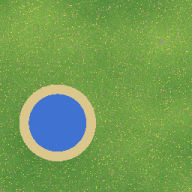
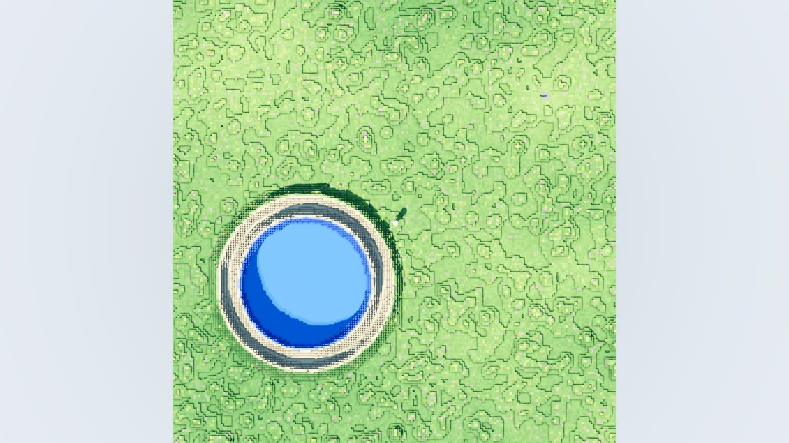
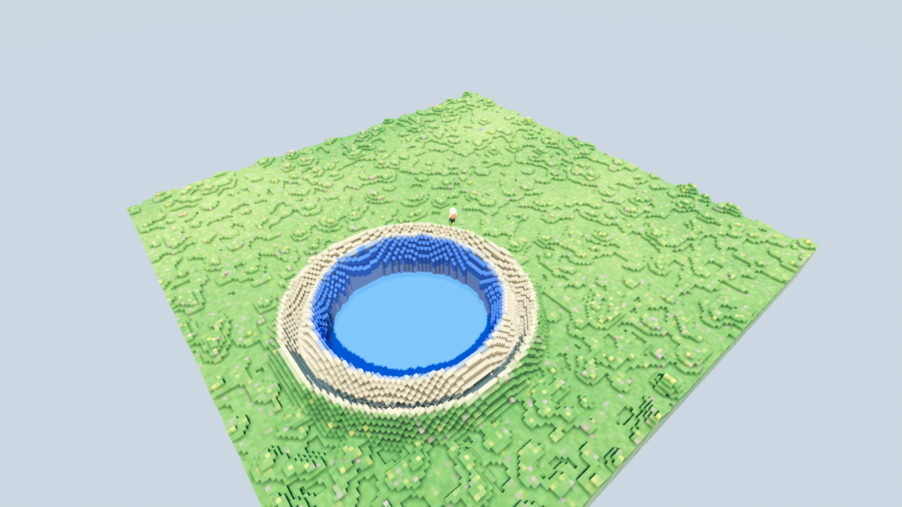
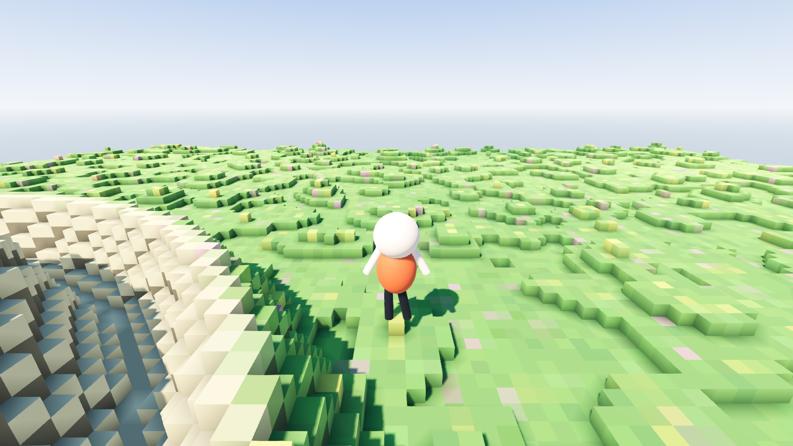

# INPC G0 결과: 사진 한 장으로 만든 블록 세계

- 날짜: 2026-11-23
- 계획: [G0 구현 계획](../superpowers/plans/2026-11-23-inpc-g0-block-world.md)
- 설계: [INPC 설계 v1.0](../superpowers/specs/2026-11-23-inpc-design.md) §6-3, §7 G0, §8

## 판정

| 확인할 것 | 결과 |
|---|---|
| 사진 한 장으로 파일 맵을 만들고 걸어 다닌다 | 됨. 192×192칸, 청크 219개, 삼각형 약 22만 개 |
| 내장 그래픽에서 1920×1080, 중간 화질 30fps | **통과.** 평균 46.7fps(기본 사진), 52.2fps(가장 울퉁불퉁한 사진) |
| 같은 사진이면 같은 세계 | 됨. 테스트로 고정했고, 실행할 때마다 시드가 같다 |
| 사진처럼 보이는가 | **사용자 확인 필요.** 아래 "높이 규칙에서 본 것" 참고 |

## 성능

측정 장비: Intel Iris Xe 내장 그래픽, 전체 화면 1920×1080, 수직 동기화 끔, 30초 정해진 카메라 경로(앞 절반은 눈높이, 뒤 절반은 20m 위).

| 사진 | 화질 | 평균 fps | 하위 1% fps | 최저 fps | 삼각형(그림자 포함) | 드로콜 |
|---|---|---|---|---|---|---|
| 기본(초원) | 중간 | 46.7 | 29.0 | 27.4 | 666,850 | 640 |
| 무작위 잡음(최악) | 중간 | 52.2 | 33.2 | 31.9 | 645,390 | 822 |
| 무작위 잡음(최악) | 낮음 | 62.6 | 38.4 | 37.3 | 200,130 | 259 |
| 기본(초원), 창 1920×1055 | 중간 | 56.2 | 32.1 | 30.8 | 666,850 | 640 |

- 평균은 모두 기준(30fps)을 넘어서, 계획에 정해 둔 최적화(그림자 거리 줄이기, 보이는 거리 제한, 같은 색 면 합치기)는 적용하지 않았다.
- 기본 사진의 하위 1%가 29fps로 기준선에 붙어 있다. G1부터 블록을 고치고 물이 흐르면 청크 메시를 다시 만들 일이 생기므로, 그때 같은 벤치를 다시 돌린다.
- 중간 화질에서 삼각형이 세 배로 느는 것은 해 그림자 때문이다. 여유가 필요하면 그림자 거리를 먼저 줄인다.
- 세계를 만드는 데 사진 처리 40~60ms, 메시 생성 0.6~1.1초가 걸렸다.

## 스크린샷 (기본 사진)

| 원래 사진(192×192로 준비한 것) | 위에서 본 세계 |
|---|---|
|  |  |





## 높이 규칙에서 본 것

지금 규칙은 "무늬가 많은 곳은 언덕, 고른 곳은 평지"(설계 §6-3)를 이렇게 옮긴 것이다. 높이의 65%가 주변 밝기 변화량(무늬)에서, 35%가 밝기에서 나온다.

기본 사진에서 보이는 결과는 이렇다.
- 색이 바뀌는 **경계선이 둑이 된다.** 연못 둘레의 모래와 풀 경계가 둥근 둑이 되면서 연못이 분화구처럼 깊어 보인다.
- 사진 속 회색 바위 언덕(오른쪽 위)은 오히려 낮다. 바위 부분 안쪽은 무늬가 고르기 때문이다.
- 풀밭의 잔무늬가 0.25m 턱으로 촘촘히 올라온다. 걷기에는 문제가 없다(자동 오르기 확인).

실제 사진은 기본 사진과 다르게 나올 수 있으니, 사용자 사진으로 먼저 본다. 고칠 때 후보는 다음과 같다(설계에서 높이 공식은 빌더 재량이다).
1. 밝기 비중을 높인다. 밝은 곳이 높아져서 하늘이 높은 벽이 되는 단점이 있다.
2. 무늬 창을 넓혀(5×5 → 9×9) 경계선 둑을 넓고 낮은 언덕으로 바꾼다.
3. 넓은 영역 단위로 높이를 정하고, 무늬는 작은 높낮이만 주게 한다.

## 계획과 달라진 것

- 캐릭터 충돌체를 캡슐에서 원기둥으로 바꿨다. 캡슐의 둥근 밑면이 0.25m 턱 모서리에 걸터앉아 자동 오르기가 시작되지 않았다(걷기 시험에서 82%만 감).
- 걷기 시험용 인자 `--walktest=초`를 넣었다. 가장 높은 칸 쪽으로 저절로 걸으며 위치를 찍는다. 계단형 사진과 기본 사진에서 기대 거리를 모두 걸었다.
- 사진 파일은 .NET으로 읽는다. Godot의 파일 읽기는 실패할 때 경로를 출력하기 때문이다.
- 블록 색을 sRGB로 표시했다. 첫 화면이 하얗게 바래 보였다.

## 사용자 확인 목록

실행 명령은 PowerShell에서 아래처럼 쓴다.

```
C:\Users\ljsn1\Desktop\Project\HANGBAR\scripts\game\run.ps1 -Photo "사진 경로"
C:\Users\ljsn1\Desktop\Project\HANGBAR\scripts\game\shots.ps1 -Photo "사진 경로" -Out "저장할 폴더"
C:\Users\ljsn1\Desktop\Project\HANGBAR\scripts\game\bench.ps1
```

`shots.ps1`의 저장 폴더는 저장소 밖으로 둔다. 본인 사진은 저장소에 올리지 않는다.

- [ ] 본인 사진 서너 장(풍경, 인물, 음식, 화면 캡처)으로 `shots.ps1`을 돌려 "내 사진으로 만든 세계" 같은지 본다. 같은 폴더에 `photo.png`(준비된 원래 사진)가 함께 저장된다.
- [ ] `run.ps1`로 걸어 본다. 클릭하면 마우스가 잡히고 Esc로 놓인다. WASD 이동, Shift 달리기, Space 점프, F3 성능 표시.
  - [ ] 언덕을 오를 때 0.25m·0.5m 턱에 걸리지 않는다.
  - [ ] 0.75m(3칸) 턱은 점프해야 오른다.
  - [ ] 연못 바닥으로 떨어졌다가 걸어 나올 수 있다(수영은 G2).
  - [ ] 맵 끝에서 보이지 않는 벽에 막힌다.
- [ ] 외장 그래픽 PC가 있으면 `bench.ps1`을 한 번 더 돌린다.
