# INPC 2판-1 결과: 장면 변형 4종(해변, 수영장, 집, 산)

- 날짜: 2026-11-25
- 계획: [2판 1부 구현 계획](../superpowers/plans/2026-11-24-inpc-world-v2-part1.md)
- 설계: [세계 생성기 2판 설계](../superpowers/specs/2026-11-24-inpc-world-generator-v2-design.md) §5, §6-4, §6-8
- 브랜치: `inpc-world-v2-1`

> **2026-11-25 그림체를 바꿨다.** 이 문서의 아래 수치와 그림은 처음 그림체(8×8 픽셀 무늬, 기본 도형 캐릭터) 기준이다. 사용자가 화면을 보고 "마인크래프트 느낌이 살짝 나고, 나무와 캐릭터가 인위적이며 귀엽지도 재밌지도 않다"고 했다. 시험판을 거쳐 지금 그림체로 바꿨다. 바뀐 내용은 [그림체 바꿈](#그림체-바꿈-2026-11-25)에 있다.

## 판정

| 확인할 것 | 결과 |
|---|---|
| 장면 4종이 만들어지고 게임에서 실행된다 | 됨. `--scene=beach·pool·house·mountain` |
| 블록 질감(8×8 무늬, 금·이끼·닳음) | 됨. 셰이더가 Core의 `BlockPattern`을 그대로 옮겼다 |
| 첫 화면이 바라볼 대상을 향한다 | 됨. 해변은 바다, 수영장은 수영장 끝, 집은 거실 창, 산은 봉우리 |
| 숨겨진 벽화 | 됨. 시드 10개마다 숨김·거리 40칸 이상·걸어서 도달을 테스트로 확인 |
| 내장 그래픽 1920×1080 중간 화질 30fps | **통과.** 네 장면 평균 47.9~60.5fps |
| 마인크래프트처럼 보이지 않는가, 실내 카메라, 벽화 찾기 | **사용자 확인 필요** (아래 목록) |

## 성능

측정 장비: Intel Iris Xe 내장 그래픽, 창 1920×1055, 수직 동기화 끔, 30초 정해진 카메라 경로. 경로의 앞 절반은 눈높이로 돌고 뒤 절반은 20m와 "가장 높은 땅 + 5m" 중 높은 쪽에서 돈다. 사진은 기본 사진(초원)이다.

| 장면 | 평균 fps | 하위 1% fps | 최저 fps | 삼각형(그림자 포함) | 드로콜 | 청크 |
|---|---|---|---|---|---|---|
| 산 | 60.5 | 34.9 | 32.8 | 1,452,040 | 1,504 | 559 |
| 해변 | 47.9 | 29.5 | 25.3 | 1,309,206 | 1,640 | 557 |
| 수영장 | 51.8 | 34.0 | 30.5 | 1,370,520 | 1,383 | 476 |
| 집 | 51.5 | 34.4 | 26.8 | 1,549,494 | 1,564 | 534 |

- 처음 측정에서는 평균이 35.7~46.1fps였고 삼각형이 프레임당 1,000만 개를 넘었다. 원인은 둥근 소품으로, Godot 구와 원기둥의 기본 분할 수가 높아서 나무 한 그루가 삼각형 수천 개가 됐다. 구를 12×6, 원기둥을 8면으로 줄이자 위 수치가 나왔다.
- 해변의 하위 1%(29.5fps)가 기준선에 붙어 있다. 바다 수면과 해저가 한꺼번에 보이는 구간이다. 소품과 물을 더 늘릴 때 같은 벤치를 다시 돌린다.

세계 한 장(192×192×160칸)의 블록 메시 삼각형 수는 아래와 같다. 그림자와 소품은 빠진 수치이고, 예산은 45만 개다.

| 장면 | 삼각형 | 걸어서 닿는 칸 | 벽화 자리 | 랜드마크(기본 사진 시드) |
|---|---|---|---|---|
| 해변 | 401,218 | 98% | 바위 곶의 바다 동굴 안쪽 벽(10×10) | 등대 |
| 수영장 | 330,786 | 99% | 탈의실 기계실 안의 액자(6×8) | 다이빙대 |
| 집 | 392,480 | 98% | 지하 숨은 방의 액자(10×9) | 온실 |
| 산 | 372,228 | 100% | 봉우리 북쪽 절벽(32×18) | 큰 나무 |

## 그림 (기본 사진)

저장소에는 기본 사진(`SamplePhotos.Meadow`)으로 만든 그림만 둔다. 사용자 사진으로 만든 그림은 올리지 않는다.

`tools/world-preview`의 등각 그림과 게임 화면(캐릭터 뒤 첫 화면, 비스듬히 위에서)이다.

| 장면 | 미리보기 | 첫 화면 | 위에서 |
|---|---|---|---|
| 해변 | 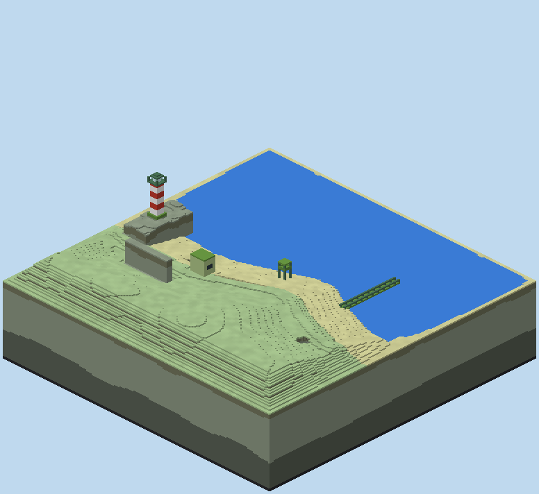 | 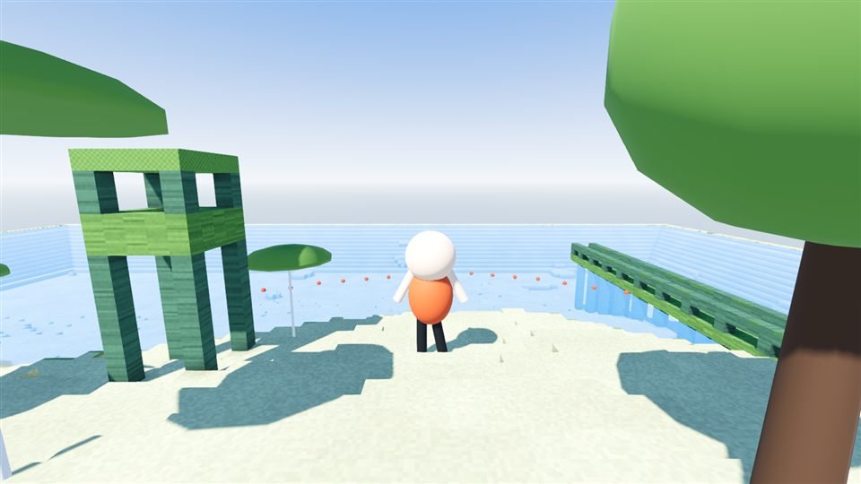 | 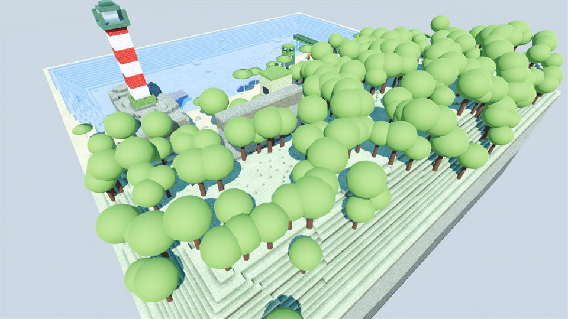 |
| 수영장 | 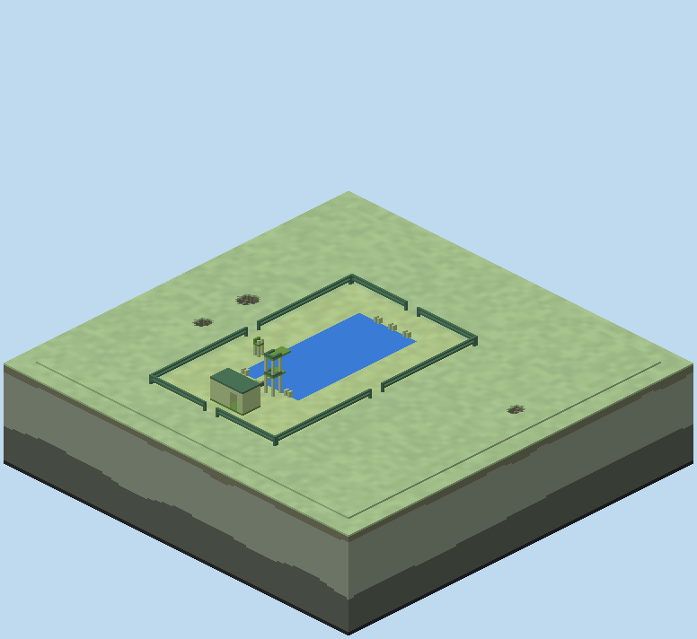 | 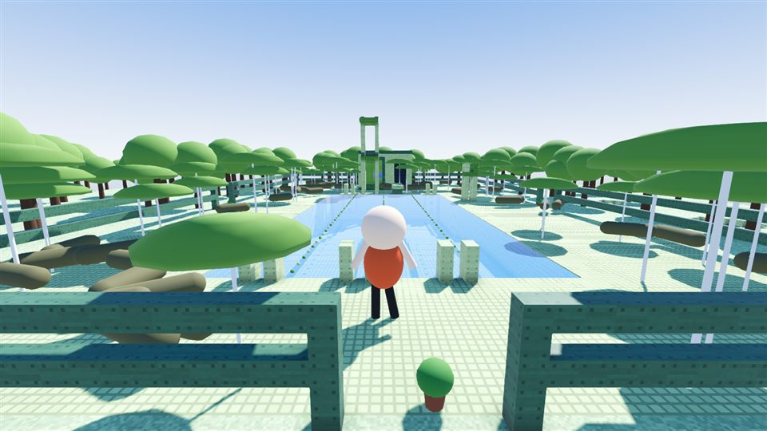 | 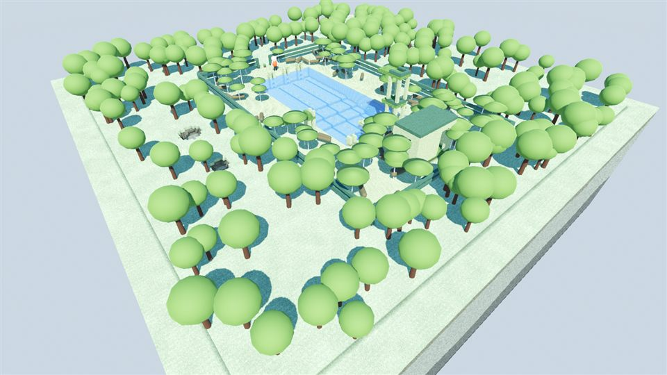 |
| 집 | 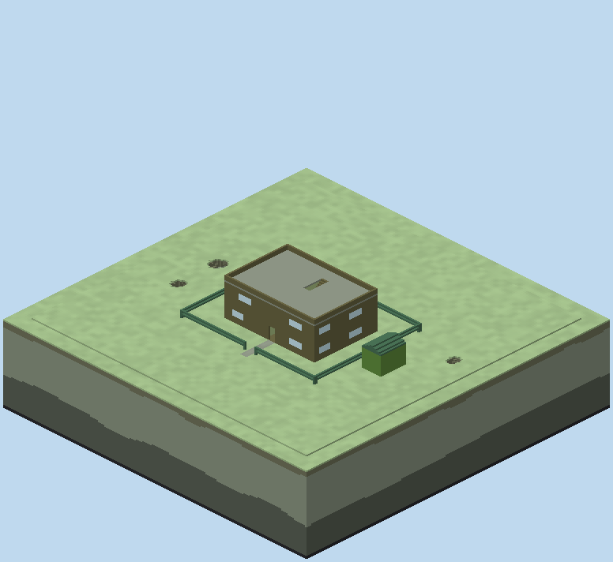 | 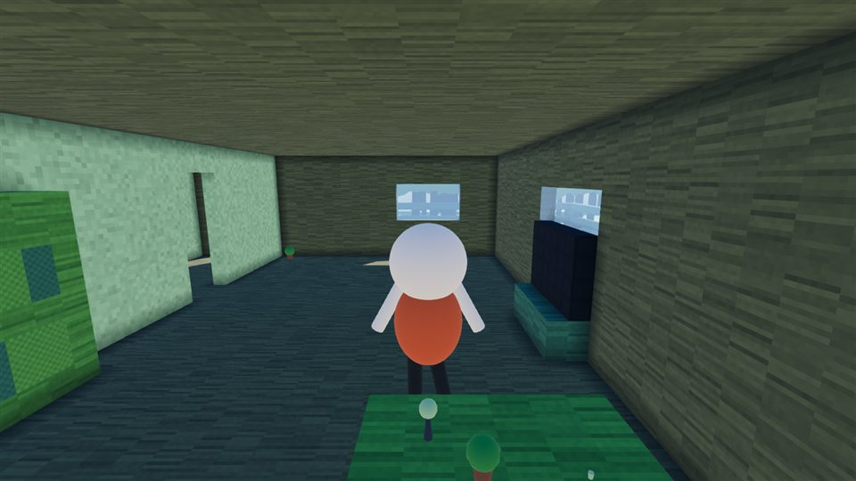 | 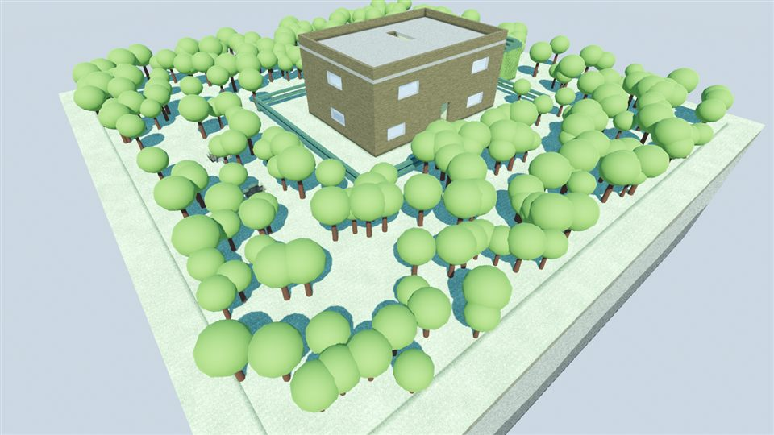 |
| 산 | 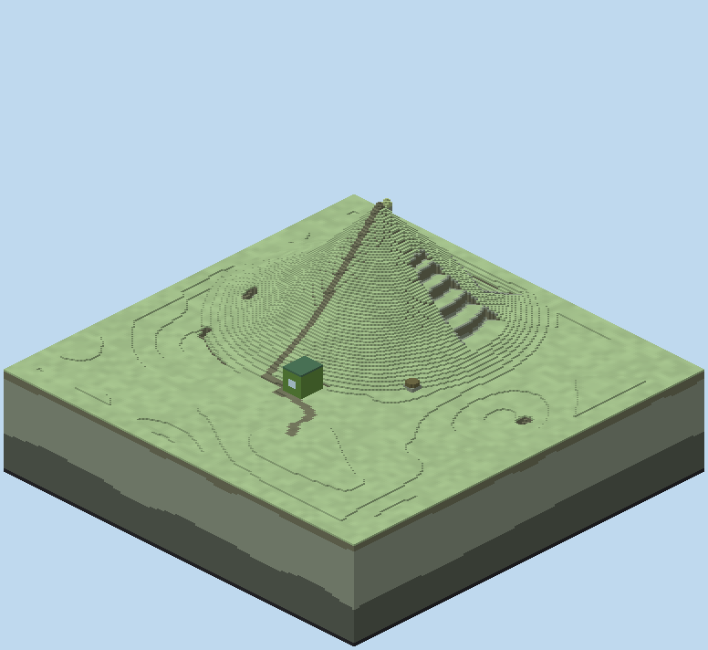 | 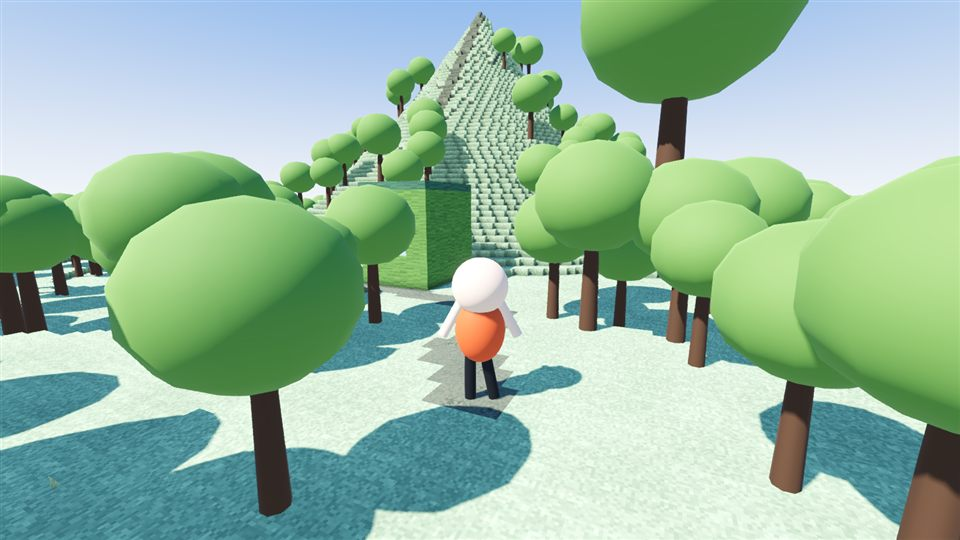 | 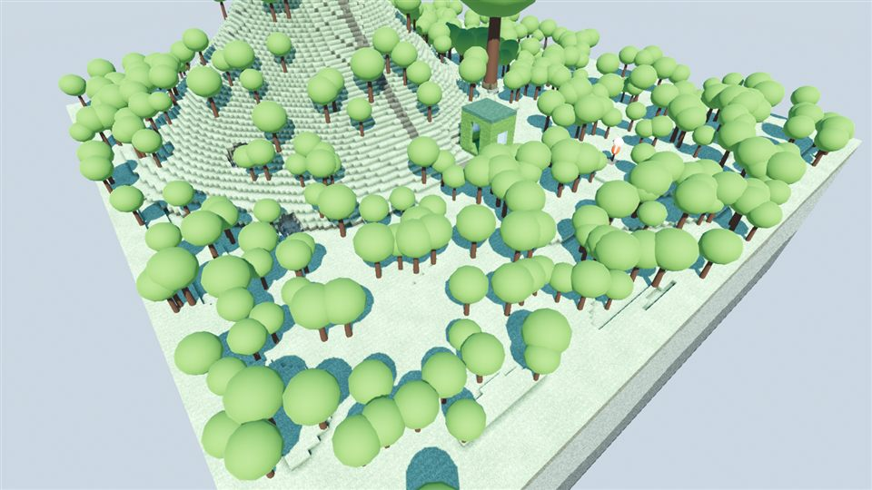 |

그림을 다시 만들 때는 아래 명령을 쓴다. 사용자 사진으로 볼 때는 출력 폴더를 저장소 밖으로 둔다.

```
dotnet run --project tools/world-preview -- --scene=all --out=폴더
.\scripts\game\shots.ps1 -Scene beach -Out "폴더"
```

## 계획과 달라진 것

- **소품 규칙을 생성기 공통 단계로 넣었다(`PropRules`).** 게임 화면을 찍어 보니 산의 첫 화면이 나무에 가려 봉우리가 보이지 않았다. 집에서는 바깥 나무의 둥근 수관이 벽을 뚫고 거실로 들어왔다. 그래서 장면마다 소품을 놓은 뒤 두 가지를 지운다. 하나는 카메라(출발점 뒤 20칸)에서 바라볼 대상까지의 시야 안에 있는 큰 소품(나무, 덤불, 파라솔, 벤치, 바위)이다. 다른 하나는 수관이 구조물과 겹치는 나무다. 두 규칙 모두 장면 4종 테스트로 고정했다. 설계 §6-8의 "출발점과 바라볼 대상 사이는 소품이 시야를 가리지 않게 비운다"를 따른 것이다.
- `GeneratedWorld`에 바라볼 대상(`Target`)을 더했다. 위 시야 규칙을 테스트하는 데 쓴다.
- 장면이 방·문·집 상자를 구조물 기록(`room_*`, `doorway`, `house`)으로 남긴다. 테스트가 방마다 가구가 있는지, 문이 4×9인지 확인할 때 쓴다.
- 계단 세 개(1층↔2층, 2층↔옥상, 1층↔지하)를 8×20 계단실 하나에 모았다. 어느 계단에서도 닿지 않는 구석은 막았다.
- 의자는 등받이 없는 2블록 높이다. 설계의 "의자 높이 2"를 지키면 등받이를 붙일 수 없다.
- 해변의 바다 동굴, 등대 곶, "해변 끝 절벽"은 바위 곶 하나로 합쳤다. 물가 12칸 안을 모래로 80% 이상 채운다는 규칙과 바위 덩어리 세 개가 함께 들어가지 않았다.
- 집 마당(울타리 안)의 나무는 성기게 두었다. 처음에는 바깥과 같은 밀도여서 마당이 숲처럼 보였다.
- 미리보기 도구의 등각 그림이 돌출부 아래 벽도 그리게 고쳤다. 등대 전망대에 가려 탑 몸통이 통째로 빠졌다.
- 벤치는 캡슐을 눕혀 그린다.
- **최종 검토에서 고친 것.** 사진 블록은 여섯 면 모두에 사진 색을 보인다. 그래서 1블록 두께 벽에 건 벽화는 뒤에서도 좌우가 뒤집힌 채 보였다. 수영장 기계실의 액자가 그래서 출발점에서 보였다. 이제 숨김 판정은 그림 뒷면도 검사한다. 기계실 앞벽은 2겹으로 바꿨고, 대체 벽에는 돌 뒷판을 붙인다. 대체 벽은 맵 가장자리에서 6칸 이상 떨어진 자리에만 세워서 그림 앞에 설 공간을 남긴다.

## 사용자 확인 목록 (Windows)

저장소 폴더(HANGBAR)에서 PowerShell로 실행한다.

```
.\scripts\game\run.ps1 -Scene beach
.\scripts\game\run.ps1 -Scene pool
.\scripts\game\run.ps1 -Scene house
.\scripts\game\run.ps1 -Scene mountain
.\scripts\game\run.ps1 -Scene beach -Photo "사진 경로"
.\scripts\game\bench.ps1 -Scene mountain
```

- [ ] 장면 4종이 실행되고 첫 화면이 바라볼 대상을 향한다
- [ ] 질감이 마인크래프트처럼 보이지 않는다(블록 색은 사진에서 오고 무늬는 압축 얼룩)
- [ ] 집 안에서 카메라가 벽에 끼지 않는다(마우스로 돌려 본다)
- [ ] 숨겨진 벽화를 찾을 수 있다(해변은 바위 곶의 바다 동굴, 수영장은 탈의실 뒤 기계실, 집은 지하, 산은 봉우리 북쪽 절벽)
- [ ] `bench.ps1 -Scene mountain` 평균 30fps 이상
- [ ] 사용자 사진 3장 이상을 장면마다 넣어 본다(색과 분위기가 사진을 닮았는가)

## 벤치 결과 (다른 장비에서 잰 것)

| 날짜 | 장비 | 장면 | 화질 | 평균 fps | 하위 1% fps | 메모 |
|---|---|---|---|---|---|---|
| | | | | | | |

## 그림체 바꿈 (2026-11-25)

사용자 피드백과 참고 게임을 바탕으로 그림체를 바꿨다. 움직임은 '휴먼폴플랫'·'하우투피쉬', 배경은 'PEAK', 캐릭터는 '하우투피쉬'·'R.E.P.O.'·'PEAK'·'RV 데어 옛?' 같은 협동 게임을 참고했다. 특정 게임의 캐릭터나 화면을 따라 그리지 않고 공통된 결만 가져왔다. 시험판(`spike-style` 브랜치)을 세 번 고친 뒤 사용자가 확정했다. 과정은 [아이디어 노트](ideas.md)의 2026-11-25 항목에 있다.

**배경**
- 블록에 픽셀 무늬와 테두리가 없다. 색이 2m 단위로 천천히 바뀌어 땅이 한 덩어리로 보인다. 윗면은 밝고 따뜻하게, 옆면은 서늘하게 칠한다.
- 풍화는 부드럽게 보인다. 금 간 블록은 조금 어둡고 이끼 낀 블록은 위쪽부터 초록이 번지고 닳은 블록은 밝고 흐리다.
- 하늘은 진한 파랑이고 먼 곳은 옅은 안개로 흐려진다. 사진 팔레트보다 채도를 높였다(처음 시험판은 바래 보였다).
- 나무는 각진 덩어리 세 개가 모인 수관이고 바람에 흔들린다.

**캐릭터**
- 머리와 몸이 하나인 콩 모양이다. 비니, 배낭, 가는 팔과 흰 장갑, 짧은 다리와 큰 신발을 단다. 협동할 때는 몸 색과 모자 색으로 구분한다.
- 평소 얼굴은 하이라이트가 있는 동그란 눈과 작은 입이다.
- 멍한 얼굴(`FigureFace.Dazed`)도 만들어 두었다. 크기가 다른 짝눈이 서로 다른 데를 보고 눈꺼풀이 졸린 듯 내려와 있고, 입이 벌어져 앞니 하나가 보인다. 많이 맞았을 때, 체력이 일정 이하일 때, 상태이상에 걸렸을 때 쓸 표정이다(사용자 결정). 아직 체력과 상태가 없어서 스크린샷에서만 쓴다.
- 손으로 만든 애니메이션 없이 스프링으로 움직인다. 몸이 가는 쪽으로 기울었다 되돌아오고 머리·팔·눈동자가 한 박자 늦게 따라온다. 공중에서는 팔을 허우적거리고, 착지할 때 찌그러진다. 진짜 물리로 넘어지거나 잡는 것은 설계대로 G2(캐릭터 물리)에서 만든다.

**코드**
- 게임만 바뀌었다. Core의 생성기와 테스트(415개)는 그대로다.
- `game/shaders/block.gdshader`가 새 블록 그림체이고, `game/shaders/prop.gdshader`가 소품 그림체다. 처음 그림체의 픽셀 셰이더는 지웠다. Core의 `BlockPattern`은 미리보기 도구의 근접 그림에만 쓴다.
- `--shots`가 캐릭터 사진도 남긴다: face.png, face-dazed.png, team.png(네 명), walk1–3.png, jump1–3.png.

**성능** (같은 PC, 같은 조건, 기본 사진)

| 장면 | 평균 fps | 하위 1% fps | 최저 fps | 삼각형(그림자 포함) | 처음 그림체 평균 |
|---|---|---|---|---|---|
| 산 | 45.8 | 33.7 | 32.3 | 1,558,930 | 60.5 |
| 해변 | 41.2 | 25.5 | 25.1 | 1,336,500 | 47.9 |
| 수영장 | 46.3 | 33.4 | 31.7 | 1,389,222 | 51.8 |
| 집 | 44.4 | 31.4 | 27.2 | 1,579,586 | 51.5 |

- 네 장면 모두 기준(30fps)을 넘는다. 처음 그림체보다 6~15fps 낮은데, 안개·색 보정·부드러운 그림자·흔들리는 나무 때문이다.
- 처음 옮겼을 때는 31~40fps였다. 소품 셰이더가 정점마다 역행렬을 계산하고 있었고 나무 수관이 덩어리 네 개였다. 셰이더를 세계 좌표로 계산하게 바꾸고 수관을 덩어리 세 개로 줄여 위 수치가 됐다.
- 셰이더를 바꾼 뒤 처음 실행할 때는 컴파일 때문에 몇 초 멈출 수 있다. 두 번째 실행부터는 없다.

**그림 (기본 사진)**

| 장면 | 첫 화면 | 위에서 |
|---|---|---|
| 해변 | 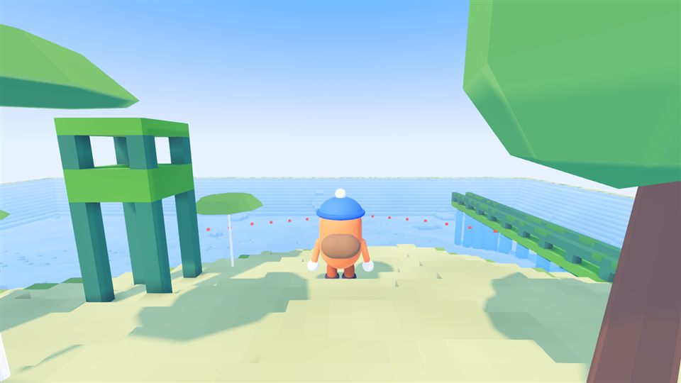 | 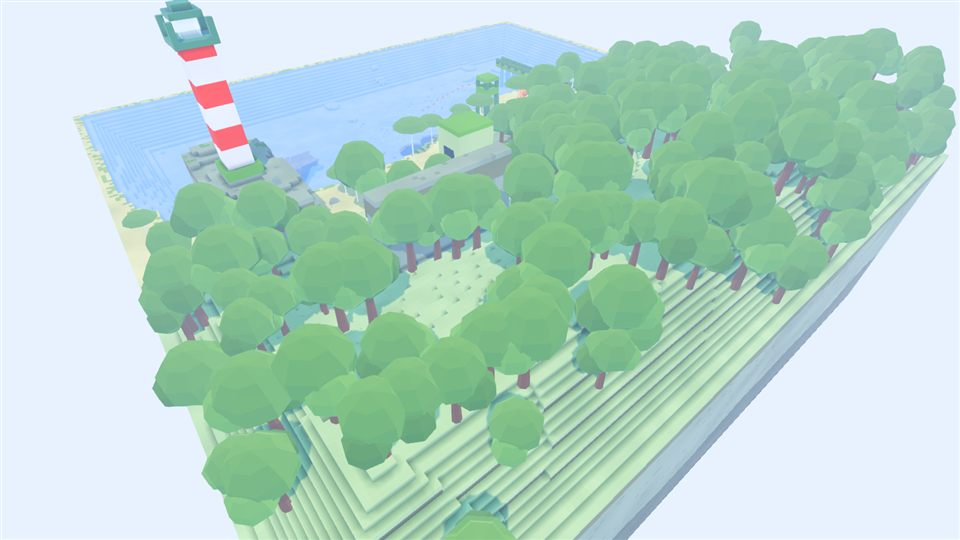 |
| 수영장 | 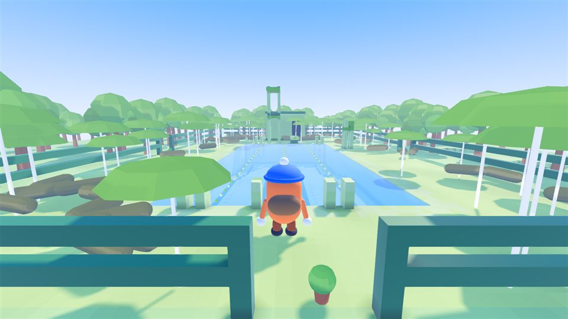 | 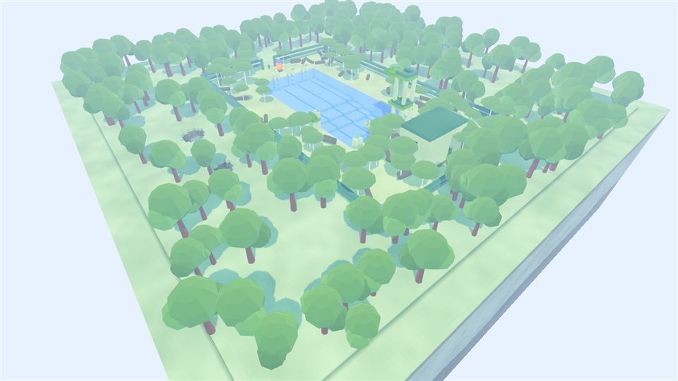 |
| 집 | 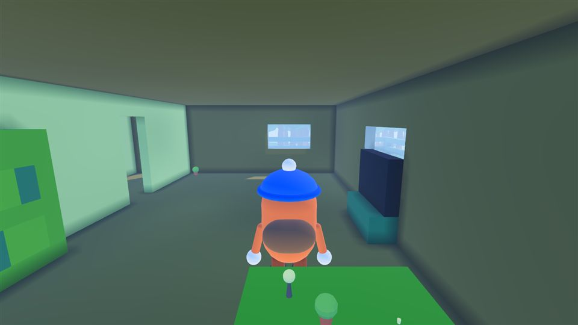 | 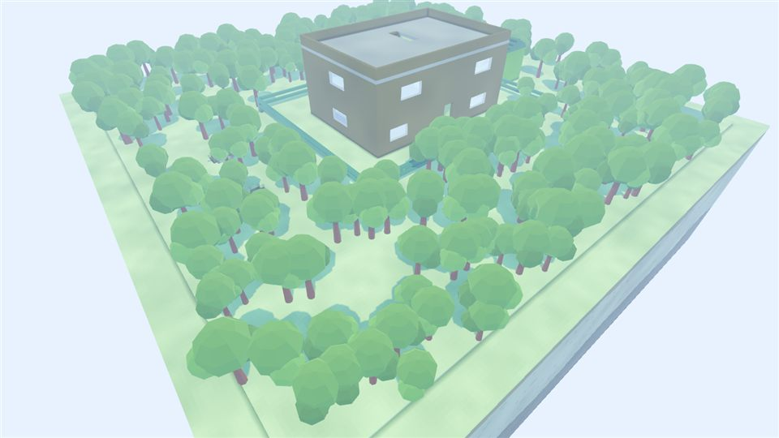 |
| 산 | 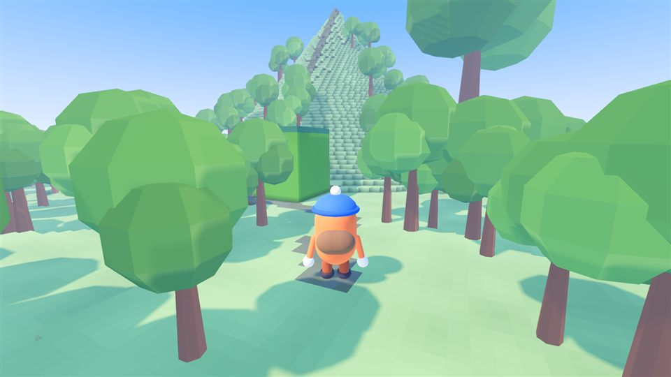 | 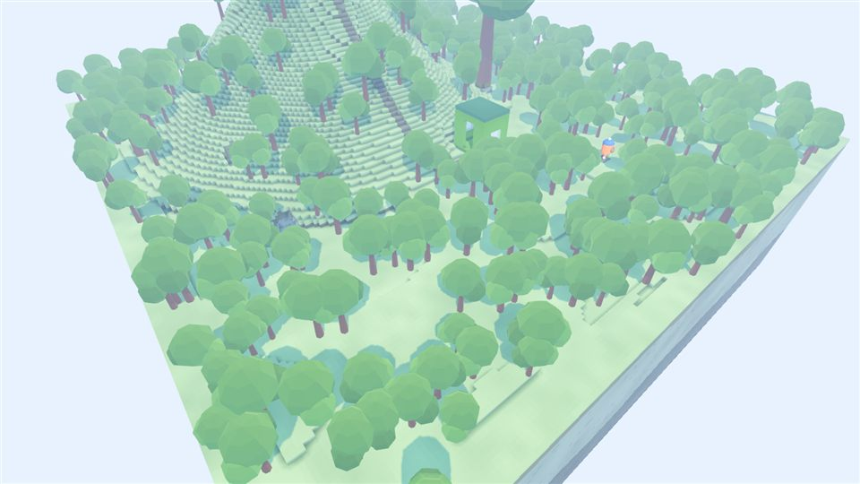 |

| 협동 네 명(보라색은 멍한 얼굴) | 평소 얼굴 | 멍한 얼굴 |
|---|---|---|
| 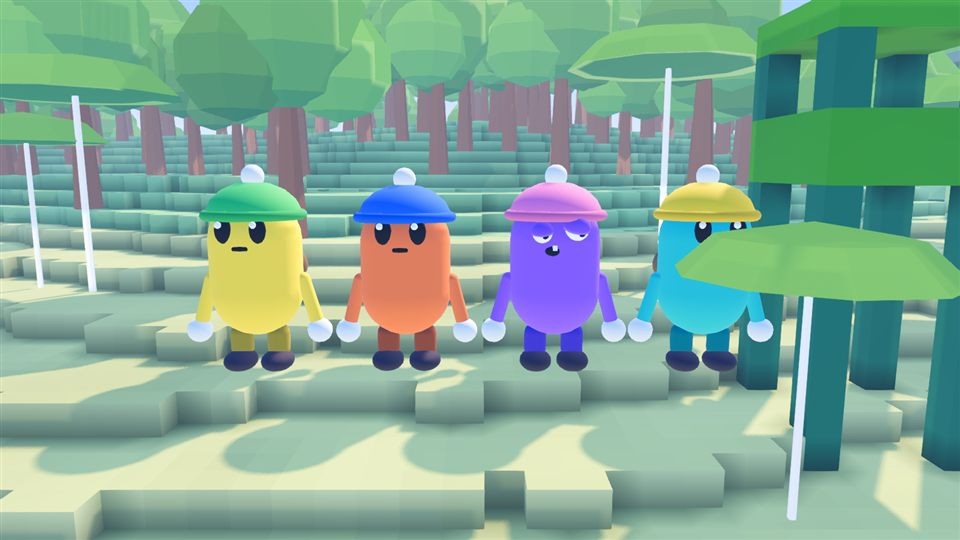 | 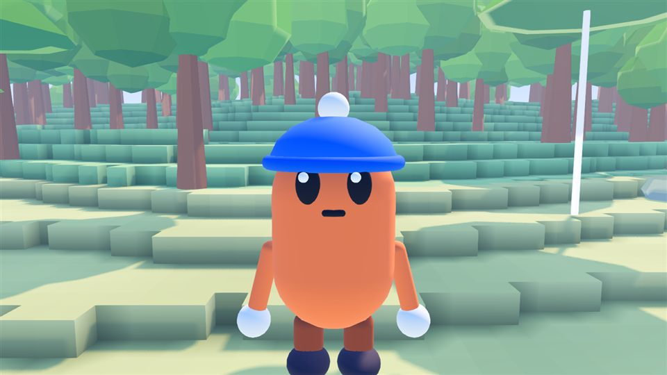 | 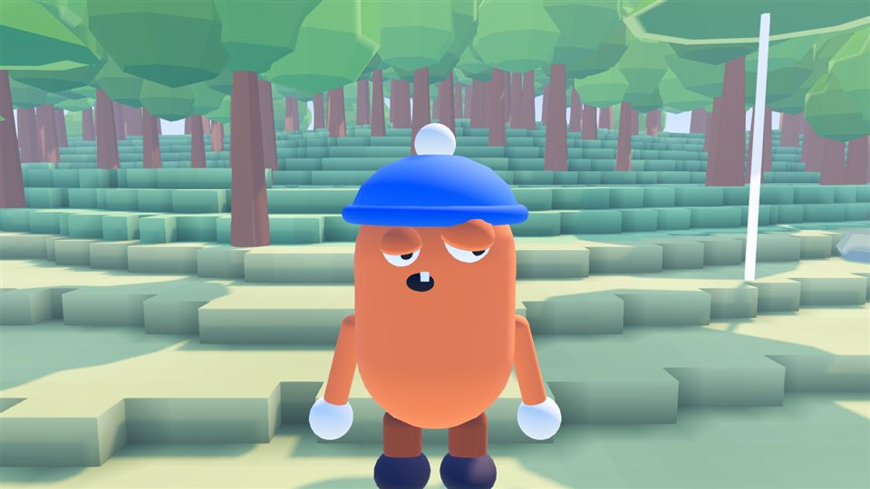 |

| 걷기 | 점프 |
|---|---|
| 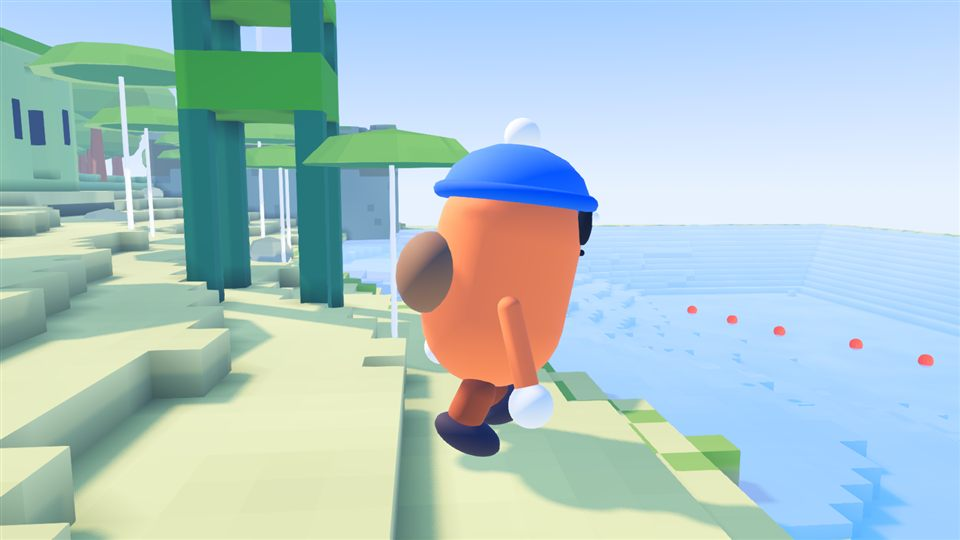 | 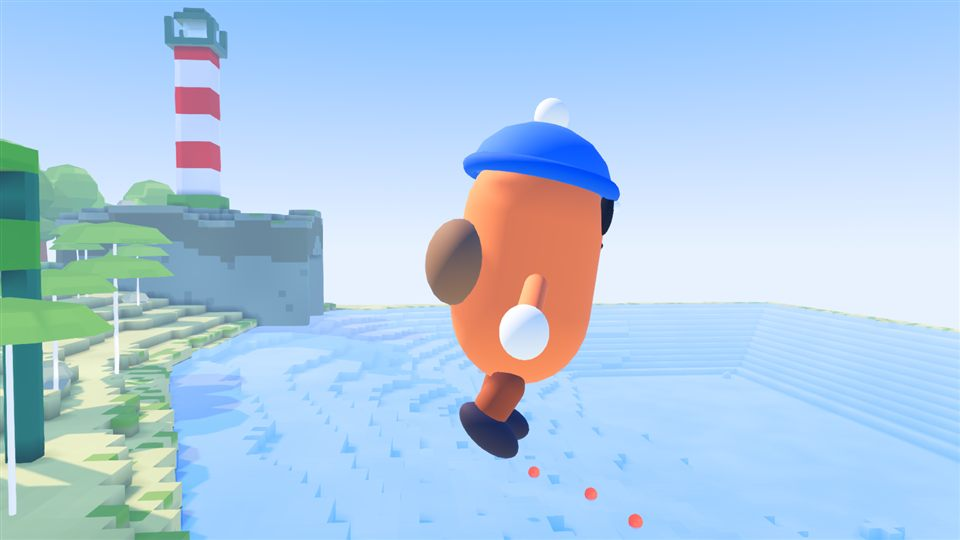 |

**새로 확인할 것**
- [ ] 직접 걷고 뛰어 보며 흔들림이 귀엽고 재밌는지(`.\scripts\game\run.ps1 -Scene beach`)
- [ ] 집 실내가 어둡다. 처음 그림체에서도 어두웠는데 무늬가 사라져 더 칙칙해 보인다. 실내 조명(전등, 실내 주변광)을 언제 다룰지 정한다.
- [ ] 이끼·금·닳음이 너무 약하거나 강하지 않은지
